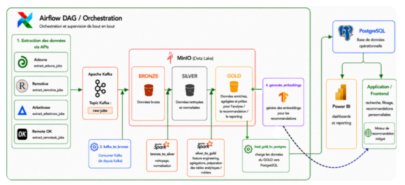
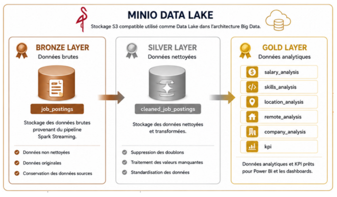
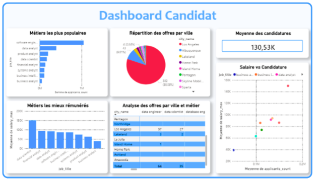
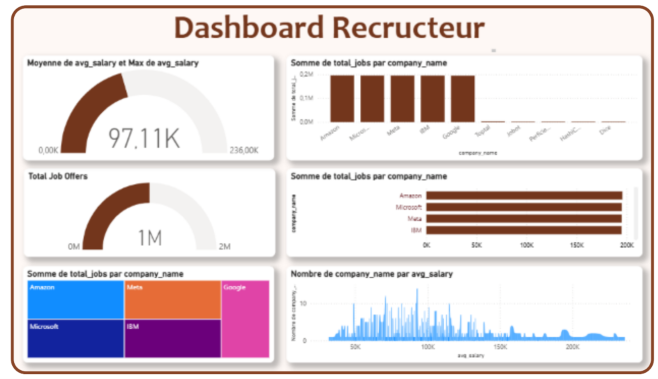

# Job Intelligent — Data Lakehouse, NLP & Business Intelligence

An intelligent job platform designed to centralize data-related job offers, recommend relevant opportunities to candidates, and provide actionable insights into the job market.

The project combines **Big Data engineering, data warehousing, NLP-based recommendation, workflow orchestration, and business intelligence**.

> **Note:** This repository is intended for project documentation and portfolio presentation purposes only. It provides an overview of the *Job Intelligent* project, including its objectives, architecture, technologies, recommendation approaches, and dashboard examples. It does **not** contain the complete source code or a runnable implementation of the platform. For further technical details, please refer to the project report included in this repository.

## Project Overview

Job opportunities are scattered across multiple platforms, making it difficult for candidates to identify relevant positions and for recruiters to understand hiring trends.

Job Intelligent addresses this challenge through a platform that combines job data ingestion and processing, personalized job recommendations, and analytical dashboards for candidates and recruiters.

Two data pipeline approaches were explored:
- **Approach 1 — Static dataset:** A pipeline built around a fixed dataset, with manually executed processing steps.
- **Approach 2 — API-based ingestion:** An automated pipeline integrating job APIs and Apache Airflow for workflow orchestration.

## Key Features

- Centralization and processing of job offers from multiple sources.
- Personalized job recommendations based on candidate profiles and NLP techniques.
- Data Lake organization using the Medallion architecture (Bronze, Silver, Gold).
- Automated data workflows with Apache Airflow.
- Interactive Power BI dashboards for job market and recruitment analytics.
- Separate analytical views for candidates and recruiters.

## Architecture

### Automated API-based pipeline

The second approach introduces automated data ingestion and workflow orchestration.

**Pipeline overview:**

1. **Data ingestion:** Job offers are retrieved from Adzuna, Remotive, Arbeitnow, and Remote OK.
2. **Messaging:** Apache Kafka centralizes incoming job data.
3. **Data Lake:** MinIO stores data in Bronze, Silver, and Gold layers.
4. **Processing:** Apache Spark Streaming cleans, transforms, and prepares data for analytics.
5. **Orchestration:** Apache Airflow schedules and coordinates pipeline tasks.
6. **Storage and analytics:** PostgreSQL supports application operations, while Power BI provides analytical dashboards.

## Recommendation Engine

The project explores two approaches to job recommendation.

| Approach | Method |
|---|---|
| Static dataset | TF-IDF and cosine similarity |
| API-based pipeline | Sentence Transformers (`all-MiniLM-L6-v2`) and cosine similarity |

Candidate profiles and job descriptions are transformed into numerical representations to estimate their similarity. Jobs are then ranked according to compatibility scores to provide personalized recommendations.

## Medallion Data Architecture

- **Bronze:** Raw job data collected from the source systems.
- **Silver:** Cleaned, deduplicated, and standardized data.
- **Gold:** Aggregated and analytics-ready data used for KPIs, dashboards, and recommendation workflows.

## Business Intelligence

Power BI dashboards provide complementary views of the job market.

### Candidate dashboard

The dashboard explores job availability, salary trends, required skills, locations, and competition between candidates.

### Recruiter dashboard

The dashboard supports analysis of hiring trends, company activity, salary levels, and the skills most requested by employers.

## Technology Stack

- **Programming & data processing:** Python, Apache Spark, Spark Streaming
- **Data ingestion & messaging:** Job APIs, Apache Kafka
- **Workflow orchestration:** Apache Airflow
- **Data Lake:** MinIO
- **Databases & data warehousing:** PostgreSQL, Microsoft SQL Server
- **NLP & recommendation:** TF-IDF, Sentence Transformers, cosine similarity
- **Business Intelligence:** Power BI

## Project Documentation

The project report documents the two pipeline approaches, system architecture, data storage organization, recommendation engine, application interfaces, and Power BI dashboards.

## Project Scope

This repository presents the project documentation and architecture. It does not claim to provide a complete, publicly available source-code implementation.

## Authors

- Salma Ben Aammi
- Oumayma Ihrissane
- Douae Laayouni

Academic project — Data Warehouse and Data Lake, 2025–2026.
